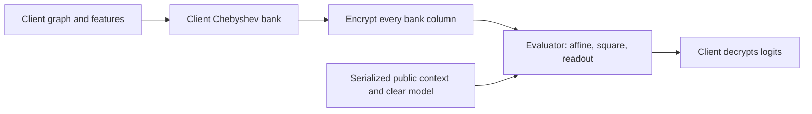

# Krylov application and interactive lab

PrivnetAI includes an independently implemented application of the client-side compilation method described in [PrivNet-Krylov](https://github.com/chimans/PrivNet-Krylov), by **Ehsan Hakimian and Chiman Soltanian**. The reviewed upstream revision is [`0976e41881192da938ef2ab988c2fe3fdb92835b`](https://github.com/chimans/PrivNet-Krylov/tree/0976e41881192da938ef2ab988c2fe3fdb92835b).

The upstream repository had no license file when reviewed. This integration contains original Python/JavaScript code and a newly generated synthetic model; it does not vendor upstream code, model artifacts, figures or benchmark results. It implements a separate shallow spectral architecture alongside the existing two-layer GCN.

## Computation

For an undirected graph, the client computes `S = D^-1/2 (A + I) D^-1/2` and the Chebyshev feature bank:

```text
B0 = X
B1 = S X
Bk = 2 S B(k-1) - B(k-2)
U  = sum_k Bk theta_k + bias
Z  = U² output_weights + output_bias
```

Every block is encrypted in the CKKS mode, including `B0`. The evaluator receives encrypted columns and the clear model, evaluates the affine/square/readout circuit, and returns encrypted class logits. It receives no adjacency or plaintext bank. The compiled evaluator uses no graph-dependent rotations. Increasing degree expands the upload by adding feature columns; it does not add graph recurrence to the evaluator.



Compilation alone provides no confidentiality: plaintext blocks can reveal graph structure. The sample graph, model and labels are public. CKKS protects the encrypted payload under its assumptions; node/feature counts, degree, model and serialized sizes remain public. Both demo roles execute locally in one process/browser, with a serialized key boundary. This is not a deployed client/server service or process isolation.

## Python application

From the repository root, the plaintext path requires NumPy and does not download a dataset:

```bash
python -m applications.krylov --backend plain --degree 2 --output /tmp/krylov-plain.json
```

Install the optional backend and execute real encryption:

```bash
pip install -r requirements-ckks.txt
python -m applications.krylov --backend ckks --degree 2 --output /tmp/krylov-ckks.json
```

The CKKS backend uses TenSEAL, serializes a public/evaluation context without the secret key, reconstructs the evaluator's ciphertexts from bytes, then decrypts only with the client context. Missing TenSEAL or unsupported circuits produce an error rather than a plaintext fallback. The result records parameters, environment, payload sizes, stage timings, errors and same-model prediction agreement. Only the square activation is supported in this encrypted demonstration.

The library exposes `normalize_adjacency`, `compile_chebyshev_blocks` and `evaluate_model` from `applications.krylov`. `applications.krylov.ckks` exposes `client_encrypt_blocks`, `evaluate_server` and `run_ckks`. The evaluator's request type has no graph, labels, plaintext features or secret-key field.

Use `--fixture path/to/fixture.json` to evaluate an existing browser-schema fixture. It defaults to that fixture's `default_degree` unless `--degree` is supplied. Input, result and fixture-export paths must be distinct; the CLI caps fixture files at 1 MiB and validates graph/model dimensions before allocating the graph shift.

## Browser lab

The GitHub Pages application runs without a hosted API. Visitors can change degree and feature perturbation, inspect the graph and per-node predictions, compare the compiled result with an independent direct polynomial evaluation, import a local JSON fixture, and export diagnostics. Imported graph data stays in the browser. The default mode is explicitly **local plaintext**.

The separate **real CKKS** action loads node-seal WebAssembly on demand and encrypts the bundled demo's compiled columns. A fresh evaluator context is reconstructed from serialized public parameters/keys and ciphertexts. The secret key stays with the local client. The page reports actual encryption/evaluation/decryption measurements and errors against the identical plaintext model. It does not upload the bank or secret key to a remote evaluator. Encrypted execution is limited to the bundled fixture; custom fixtures use the plaintext lab.

For development, use Node 24 and the committed lockfile:

```bash
npm ci
npm run dev
```

For a production build and validation:

```bash
npm test
npm run build
npx playwright install chromium
npm run test:browser
```

The Vite build uses relative asset paths, so it works under the GitHub Pages project path `/PrivnetAI/`. All runtime code and the WASM binary are packaged with the site; an external CDN is not required. The first encrypted run downloads the WASM asset and creates fresh keys, so it is slower than plaintext execution and can use substantial memory.

## Fixture and measurement scope

The bundled JSON at [site/data/demo.json](../site/data/demo.json) describes 24 synthetic nodes in two communities, 3 features, a degree-4 parameter bank, 4 hidden channels and 2 classes. Two local ridge fits train the square model using **all nodes**. The default degree is 2. Changing degree truncates the fixed parameter bank; it does not retrain the model.

Displayed accuracy is illustrative all-node/training accuracy, not a held-out generalization result. The demo does not reproduce upstream research benchmarks, claims of speedup, or post-quantum security. Plaintext and CKKS use the same selected degree, features, parameters and activation.

Regenerate the public fixture with:

```bash
python -m applications.krylov --export-demo site/data/demo.json --output /tmp/krylov-plain.json
```

Custom JSON uses the same schema: `schema_version`, `nodes`, unique undirected `edges`, `features`, integer `labels`, `default_degree`, and `model` containing `theta`, `bias`, ascending `activation_coefficients`, `output_weights` and `output_bias`. Node IDs are consecutive integers starting at zero. Shapes must agree. The browser limits graph/model size and rejects invalid, nonfinite or excessively large files.

## Security and publication boundaries

The demo CKKS tuple is polynomial modulus degree 16,384, coefficient-modulus bits `[60, 40, 40, 40, 40, 60]`, scale `2^40`. It passes SEAL's default classical parameter validation. This is not an independent concrete-security estimate, a post-quantum security claim, malicious-server integrity, or an output-oracle defense. The bundled backend releases are for experimental demonstration; publication-quality security assessment and a hardened network protocol require separate work.

The new Krylov/browser checks are in `.github/workflows/krylov.yml`. The legacy simulator precision defect documented in the [research archive](research/2026-10-10/README.md) remains independent of this application.

The initial tested site is published from a generated `gh-pages` branch at [aliaslany.github.io/PrivnetAI](https://aliaslany.github.io/PrivnetAI/). For subsequent updates, `.github/workflows/pages.yml` builds and tests the site on `main`, uploads a Pages artifact and deploys it using GitHub's supported Pages actions. It also supports manual dispatch. Source changes are reviewed through a feature PR; the initial demo can be tested before that PR is merged. Pages settings must select GitHub Actions for this ongoing deployment workflow.

The initial branch publication was verified live, including real browser CKKS and result export. Repository setup for subsequent `main` deployments is:

1. In [Pages settings](https://github.com/aliaslany/PrivnetAI/settings/pages), select **GitHub Actions** as the source.
2. In [environment settings](https://github.com/aliaslany/PrivnetAI/settings/environments), ensure the `github-pages` environment permits deployment from **main**. The initial branch publication permits `gh-pages`; keep it if needed.
3. Merge the feature PR, or manually dispatch **Publish PrivnetAI Pages** after merging.

The integration's API credential can publish repository branches but GitHub returned HTTP 403 when asked to change Pages settings. These settings steps do not affect using the already published demo.
